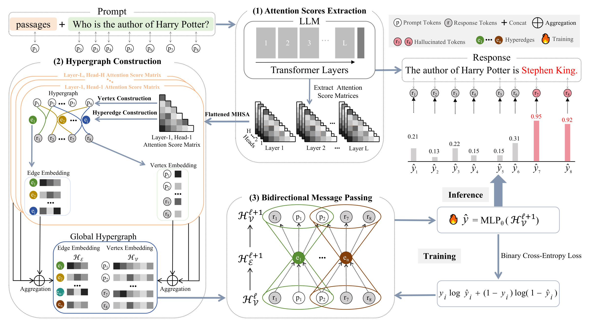

# Hypergraph Modeling of Transformer Attention for Hallucination Detection

Official implementation of [Hypergraph Modeling of Transformer Attention for Hallucination Detection](https://neurips.cc/virtual/2026/loc/sydney/poster/154475) (NeurIPS 2026).

The framework represents token-level transformer attention as a hypergraph: each token is a node, and for every response token, the tokens it attends to (above a threshold `tau`) form a hyperedge across all attention heads. A message-passing model (**AttnHyper**) then predicts a per-token hallucination probability.



*(Vector source: [`images/framework.pdf`](images/framework.pdf))*

## Requirements

- Python 3.11 or 3.12
- Linux x86_64 / Windows x86_64 with an NVIDIA GPU (driver >= 450.80.02; the pinned `torch==2.4.1+cu118` bundles the CUDA runtime)

To install requirements:

```setup
pip install -r requirements.txt
```

The file pins all direct dependencies and already includes the `--extra-index-url` needed for the `+cu118` torch build.

## Data

The pipeline uses the [RAGTruth](https://arxiv.org/abs/2401.00396) benchmark (QA / Summary / Data2txt). By default the scripts expect:

- Dataset: `../../datasets/RAGTruth/{response.jsonl, source_info.jsonl}` (override with `--data_dir`)
- Local HuggingFace models: `../../models/<model_name>` (override with `--model_path`)

RAGTruth responses come from two generators: `llama-2-7b-chat` and `mistral-7B-instruct`. The data subset is selected automatically from the local model name — Mistral models use `mistral-7B-instruct` responses, any other model defaults to `llama-2-7b-chat` responses.

## Pipeline

### 1. Attention extraction (`get_attention.py`)

Runs the local LLM over each RAGTruth sample and stores all-layer attention maps plus token-level hallucination labels.

```bash
python get_attention.py --model_path ../../models/llama-2-7b-chat-hf --split train --task_type Data2txt
python get_attention.py --model_path ../../models/llama-2-7b-chat-hf --split test  --task_type Data2txt
```

Output: `attention_hidden_data/RAGtruth/<model>/<split>_<task_type>/sample_N.pt`
with `attention` of shape `(layers, heads, seq, seq)`.

### 2. Hypergraph construction (`processed_hypergraph.py`)

Builds one hypergraph per sample from the attention maps:

- **Nodes**: tokens; features = self-attention values across all heads.
- **Hyperedges**: for each response token `i`, the set `{ j : attention[i,j] > tau }` plus `i` itself, for every attention head.
- **Edge attributes**: `[mean, max, normalized_head_index]`; **edge mark**: whether the hyperedge crosses the prompt→response boundary.

```bash
python processed_hypergraph.py --model llama-2-7b-chat-hf --split train --task_type Data2txt
python processed_hypergraph.py --model llama-2-7b-chat-hf --split test  --task_type Data2txt
```

Output: `hypergraphs/RAGtruth/<model>/<split>_<task_type>_<tau>_<suffix>/` (default `tau=0.05`, `suffix=notopk`).

`process_hyper_layer.py` is a single-layer variant (`--layer_id`) that builds hyperedges from one transformer layer only, writing an additional `_<layer_id>` suffix.

### 3. Training and evaluation (`train_hypergraph_multi_batchsize.py`)

AttnHyper projects node features, applies stacked node→edge→node message-passing layers with degree normalization and residuals, and scores every token with an MLP head. It is implemented as the `AttnHyper` class (with `AttnHyperLayer` message-passing layers) in `train_hypergraph_multi_batchsize.py`. Training uses `BCEWithLogitsLoss` with a response-only `pos_weight` (clipped at 8), AdamW with a cosine schedule (2% warmup), gradient clipping, and early stopping (patience 3) on validation AUPR.

```bash
# multi-seed training (seeds 1-5), per-seed results appended to logger/
python train_hypergraph_multi_batchsize.py --mode train --model_type llama-2-7b-chat-hf --task_type Data2txt

# hyperparameter grid search over hidden_dim {64,128} x gnn_layers {3,4}, results in logger/
python train_hypergraph_multi_batchsize.py --mode ablation --model_type Mistral-7B-Instruct-v0.3 --task_type QA

# train and save the best checkpoint to models/
python train_hypergraph_multi_batchsize.py --mode save --model_type llama-2-7b-chat-hf --task_type Data2txt
```

Evaluation computes **AUROC** and **AUPR** over response tokens only. With `--mode save`, the best model is stored as `models/hypergraph_<task>_<aupr>.pkl`.

Key arguments:

| Argument | Default | Description |
| --- | --- | --- |
| `--mode` | `ablation` | `train` / `ablation` / `save` |
| `--model_type` | `Mistral-7B-Instruct-v0.3` | must match the hypergraph data directory |
| `--task_type` | `QA` | `QA` / `Summary` / `Data2txt` |
| `--tau` | `0.05` | attention threshold for hyperedge membership |
| `--bs` | `2` | DataLoader batch size |
| `--data_root` | `hypergraphs/RAGtruth` | hypergraph data root |

## Results

AUROC (%) on RAGTruth. For AttnHyper (ours), mean ± standard deviation is computed across five random seeds. AttnHyper achieves the best result on all three tasks with both backbone models.

| Model | Type | Method | QA | Summary | Data2txt |
| --- | --- | --- | --- | --- | --- |
| Mistral-7B | Logits | Perplexity | 59.14 | 64.66 | 33.91 |
| Mistral-7B | Hidden | ICR | 60.96 | 55.66 | 53.33 |
| Mistral-7B | Hidden | TSV | 79.43 | 66.07 | 68.86 |
| Mistral-7B | Attention | LapEig | 76.31 | 68.39 | 66.65 |
| Mistral-7B | Attention | Lookback | 91.35 | 77.75 | 89.96 |
| Mistral-7B | Attention | **AttnHyper (ours)** | **96.18 ± 0.1** | **87.89 ± 0.8** | **94.04 ± 0.4** |
| LLaMA-2-7B | Logits | Perplexity | 54.29 | 60.81 | 36.85 |
| LLaMA-2-7B | Hidden | ICR | 58.86 | 53.86 | 60.18 |
| LLaMA-2-7B | Hidden | TSV | 78.05 | 63.57 | 66.52 |
| LLaMA-2-7B | Attention | LapEig | 79.63 | 63.34 | 65.44 |
| LLaMA-2-7B | Attention | Lookback | 85.09 | 69.65 | 85.05 |
| LLaMA-2-7B | Attention | **AttnHyper (ours)** | **90.18 ± 0.1** | **71.54 ± 0.4** | **89.51 ± 0.3** |

Per-seed metrics produced by `--mode train` are appended to `logger/llama2_<task>_results.json` or `logger/Mistral_<task>_results.json`; ablation records go to `logger/ablation_results_<task>.json`.

## Repository structure

```
├── get_attention.py                     # step 1: extract attention maps from the local LLM
├── processed_hypergraph.py              # step 2: hypergraphs from all attention heads
├── process_hyper_layer.py               # step 2 (variant): hypergraphs from a single layer
├── train_hypergraph_multi_batchsize.py  # step 3: AttnHyper training / evaluation
├── requirements.txt
├── paper_infor.md
└── images/
    ├── framework.png                    # framework overview (rendered, shown in README)
    └── framework.pdf                    # framework overview (vector source)
```

## Citation

If you find this work useful in your research, please consider citing:

```bibtex
@inproceedings{
anonymous2026hypergraph,
title={Hypergraph Modeling of Transformer Attention for Hallucination Detection},
author={Mark Junjie Li, Zhishun Liu, Wei Wang, Yuanshan Lu, Jingxi Yang, Xianyu Bao, Jun Li, Sunjie Huang},
booktitle={The Fortieth Annual Conference on Neural Information Processing Systems},
year={2026},
url={https://openreview.net/forum?id=DKOfhIFbgb}
}
```

